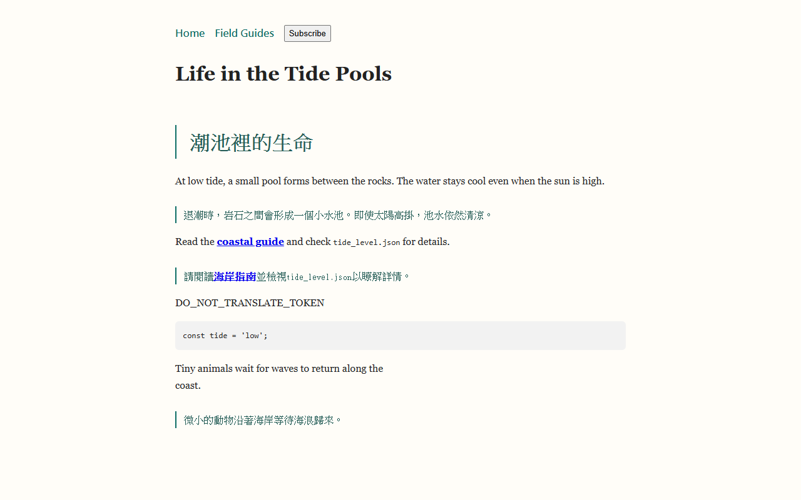
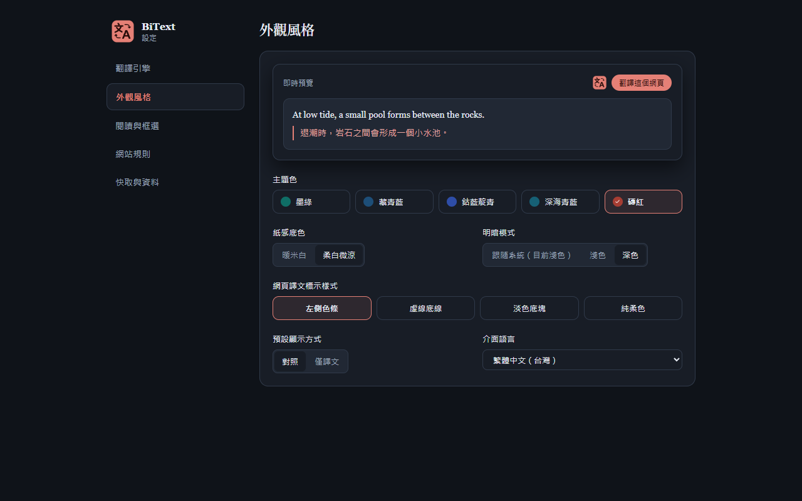

# BiText: Web Translator

[繁體中文說明](README.zh-TW.md) · [Report an issue](https://github.com/keantares/bitext-web-translator/issues)

**BiText: Web Translator** is a clean, open-source browser extension for reading foreign web pages in bilingual or translation-only mode, with selection translation.

Designed with a calm, editorial reading aesthetic (5 curated accent palettes, 2 paper surfaces, light/dark/system themes) and zero telemetry.



## Features

- **Bilingual & Translation-Only Web Reading**: Press `Alt+A` or click the toolbar icon to translate articles paragraph by paragraph while preserving clickable links, bold emphasis, and inline code blocks. Switch between bilingual and translation-only modes anytime, or restore the original page losslessly.
- **Selection Translation Popover**: Highlight any word or paragraph to translate in place. Choose between a non-intrusive floating trigger icon or immediate drag-to-translate, plus right-click context menu support and one-click copy.
- **Flexible Translation Engines** — bring your own API key, use free on-device translation, or run private local models:
  - **Chrome Built-in Translator** (Chrome 138+ desktop, free & offline, zero API key)
  - **OpenAI** (`gpt-4.1-mini`, `gpt-4o-mini`, custom models)
  - **Anthropic Claude** (`claude-haiku-4-5`, `claude-sonnet-4-5`, custom models)
  - **Google Gemini** (`gemini-2.5-flash`, `gemini-2.5-pro`, custom models)
  - **Custom OpenAI-Compatible API** (OpenRouter, DeepSeek, Groq, Together, etc.)
  - **Local Ollama** — automatic detection, one-click model download with live progress, and built-in CORS setup instructions for Windows, macOS, and Linux
  - **Local LM Studio** — automatic loaded-model discovery
- **Content Only**: Translates what people wrote — articles and posts. Navigation, buttons, tabs, sidebars, short links, account names, @handles and bare web addresses stay as written. With a Chinese target language, Chinese paragraphs (Simplified or Traditional) are left untouched and never sent for translation, while foreign posts on the same page are still shown bilingually.
- **Local Translation Cache**: Caches translations in IndexedDB for instant revisits and lower API costs, with one-click clearing in Settings.
- **Editorial Customization**: 5 curated accent colors (Forest Teal, Prussian Navy, Editorial Indigo, Deep Petrol, Brick Red), 2 paper surfaces (Warm Ivory, Cool Paper), 4 webpage translation styles (left accent bar, dotted underline, soft highlight, muted text), and full English / Traditional Chinese UI.



## Installation (From Source / Release ZIP)

### Chrome, Edge, Brave, Arc
1. Download the Chrome release ZIP (or build locally with `npm run build`).
2. Extract the archive (or locate `.output/chrome-mv3`).
3. Open `chrome://extensions`, enable **Developer mode**, and click **Load unpacked**.
4. Select the extracted folder. The welcome setup wizard will open automatically.

### Firefox
1. Build with `npm run build:firefox` (output in `.output/firefox-mv3`).
2. Open `about:debugging#/runtime/this-firefox`, click **Load Temporary Add-on…**, and choose `.output/firefox-mv3/manifest.json`.

## Local Ollama Setup Note

Ollama blocks browser extension origins (`chrome-extension://`, `moz-extension://`) with `HTTP 403` by default. If BiText detects a 403 error, follow the in-app guide or set `OLLAMA_ORIGINS`:

- **Windows**: `setx OLLAMA_ORIGINS "chrome-extension://*,moz-extension://*"` (then fully restart Ollama)
- **macOS**: `launchctl setenv OLLAMA_ORIGINS "chrome-extension://*,moz-extension://*"` (then quit and reopen Ollama)
- **Linux (systemd)**: Add `Environment="OLLAMA_ORIGINS=chrome-extension://*,moz-extension://*"` via `sudo systemctl edit ollama.service` and restart Ollama

## Development

Requirements: Node.js 22.12 or later

```bash
npm install
npm run icons          # Generate PNG icons from public/icon/logo.svg
npm run dev            # Run WXT dev server (Chrome)
npm run dev:firefox    # Run WXT dev server (Firefox MV3)
npm run typecheck      # TypeScript check
npm test               # Vitest unit tests
npm run build          # Production build for Chrome MV3
npm run build:firefox  # Production build for Firefox MV3
npm run test:e2e       # Playwright real-Chromium extension tests
npm run zip            # Package Chrome store ZIP
npm run zip:firefox    # Package Firefox AMO ZIP
```

## Privacy

BiText collects **zero analytics or telemetry**. API keys and preferences are stored solely in local browser storage. See [PRIVACY.md](PRIVACY.md) for full details.

## License

[MIT](LICENSE). Bundled third-party software is listed in [THIRD_PARTY_NOTICES.txt](public/THIRD_PARTY_NOTICES.txt).
