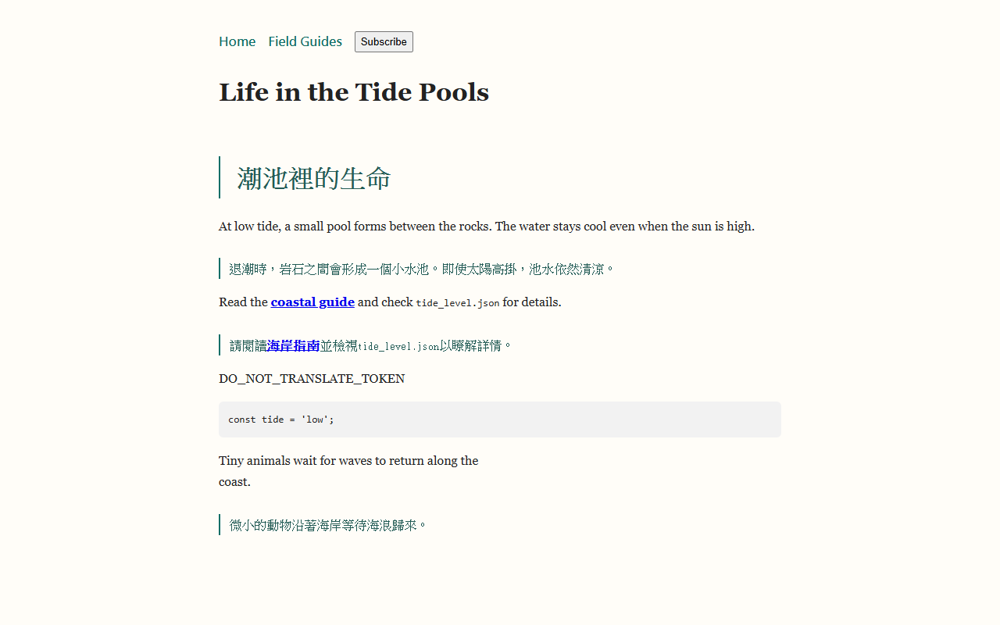
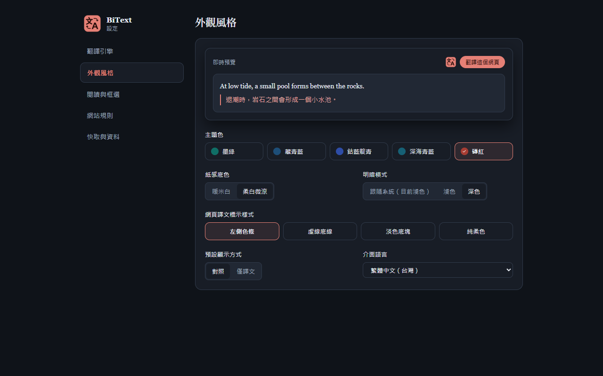

# BiText：網頁翻譯器（BiText: Web Translator）

[English README](README.md) · [回報問題](https://github.com/keantares/bitext-web-translator/issues)

**BiText：網頁翻譯器** 是一款開源、無追蹤、以「書卷閱讀」為設計理念的瀏覽器網頁翻譯擴充功能，支援雙語對照閱讀、僅譯文模式與框選翻譯。



## 主要特色

- **整頁雙語對照與僅譯文切換**：按下 `Alt+A` 或點擊工具列圖示，即可逐段翻譯外文網頁；保留原文裡可點擊的超連結、粗體與行內程式碼，隨時在「對照／僅譯文／原文」之間無損切換。
- **框選翻譯浮框**：拖選單字或段落立即翻譯，可設定「先顯示小圖示點擊才翻（避免誤觸）」或「放開滑鼠即翻」，也支援右鍵選單與一鍵複製譯文。
- **自由選擇翻譯引擎**：
  - **Chrome 內建翻譯**：桌機版 Chrome 138+ 免費離線使用，免帳號、免金鑰。
  - **雲端 AI API**：原生支援 **OpenAI**、**Anthropic (Claude)**、**Google Gemini**，以及任何**自訂 OpenAI 相容端點**（OpenRouter、DeepSeek、Groq 等）。
  - **本機 AI 模型（Ollama／LM Studio）**：自動偵測本機伺服器，支援在設定頁內**一鍵下載建議翻譯模型並顯示進度**；遇 Ollama HTTP 403 CORS 封鎖時提供 Windows／macOS／Linux 設定指令與一鍵複製。
- **只翻內容文字**：只翻譯文章與貼文；導覽列、按鈕、分頁、側欄、短連結、帳號名稱、@帳號與單獨的網址維持原文。譯文語言為中文時，簡體與繁體中文段落都維持原樣、不送翻譯，同一頁的外文貼文照常雙語顯示。
- **本機翻譯快取**：以 IndexedDB 快取譯文，重訪網頁更快且省額度，可在設定頁檢視筆數或一鍵清除。
- **書卷閱讀外觀自訂**：內建 5 款低飽和度書卷主題色（墨綠預設、藏青藍、鈷藍靛青、深海青藍、磚紅）、2 種紙感底色（暖米白預設、柔白微涼）、淺／深／跟隨系統模式、4 種譯文標示樣式（左側色條、虛線底線、淡色底塊、純柔色），並支援繁體中文與英文介面切換。



## 安裝方式

### Chrome、Edge、Brave、Arc
1. 下載 Chrome 發行壓縮檔（或自行執行 `npm run build` 編譯，產物在 `.output/chrome-mv3`）。
2. 在瀏覽器開啟 `chrome://extensions`，打開右上角**開發人員模式**。
3. 點擊**載入未封裝項目**，選取解壓縮後的資料夾（或 `.output/chrome-mv3`）。
4. 首次安裝後會自動開啟歡迎設定精靈，選擇翻譯來源即可開始使用。

### Firefox
1. 執行 `npm run build:firefox`（產物在 `.output/firefox-mv3`）。
2. 開啟 `about:debugging#/runtime/this-firefox`，點選**載入暫用附加元件…**，選取 `.output/firefox-mv3/manifest.json`。

## 本機 Ollama 連線說明

Ollama 預設會拒絕瀏覽器擴充功能來源的請求（HTTP 403）。若偵測到 403，請依作業系統設定環境變數後**完整重開 Ollama**：

- **Windows**：`setx OLLAMA_ORIGINS "chrome-extension://*,moz-extension://*"`
- **macOS**：`launchctl setenv OLLAMA_ORIGINS "chrome-extension://*,moz-extension://*"`
- **Linux（systemd）**：執行 `sudo systemctl edit ollama.service`，於 `[Service]` 加入 `Environment="OLLAMA_ORIGINS=chrome-extension://*,moz-extension://*"` 後重啟服務。

## 開發指令

需求環境：Node.js 22.12 以上

```bash
npm install
npm run icons          # 由 SVG 自動產出 16/32/48/128 PNG 圖示
npm run dev            # 啟動 Chrome 開發模式
npm run dev:firefox    # 啟動 Firefox MV3 開發模式
npm run typecheck      # TypeScript 型別檢查
npm test               # Vitest 單元測試
npm run build          # 建置 Chrome MV3 正式版
npm run build:firefox  # 建置 Firefox MV3 正式版
npm run test:e2e       # Playwright 實機 Chromium 整合測試
npm run zip            # 打包 Chrome 商店上傳用 ZIP
npm run zip:firefox    # 打包 Firefox AMO 上傳用 ZIP
```

## 隱私權

BiText **不蒐集任何遙測、瀏覽紀錄或分析資料**；所有 API 金鑰與偏好設定僅存於你的瀏覽器本機。詳見 [PRIVACY.md](PRIVACY.md)。

## 授權條款

採 [MIT 授權](LICENSE) 開源。內含的第三方開源元件與授權列於 [THIRD_PARTY_NOTICES.txt](public/THIRD_PARTY_NOTICES.txt)。
